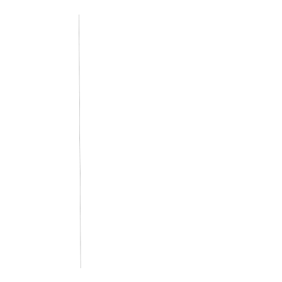
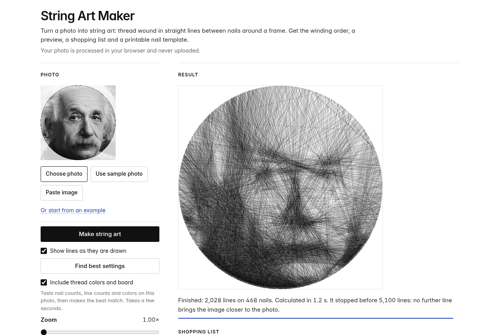

# String Art Maker

Turn a photo into string art: one thread wound in straight lines between nails around a frame.
It runs entirely in your browser, offline, and your photo never leaves your computer.



You get the picture, the winding order (which nail to go to next), a thread shopping list and a
printable full-size nail template. Circle, square, rectangle and oval frames; one to three thread
colors (DMC embroidery floss); white, black, grey or wood boards; and a "Find best settings" button
that tries nail counts, line counts and colors on your photo.

## Run it

No install, no build step, no internet needed.

**Option 1: just open it.** Download this repository (green **Code** button, then **Download ZIP**),
unzip it, and double-click `index.html`. Tested in Chromium; it uses only standard web features
(canvas, Web Workers), so any current browser should work.

**Option 2: a local server**, if you prefer:

```bash
git clone <this repo's URL>
cd string-art
python3 -m http.server 8000
# then open http://localhost:8000
```

Click **Use sample photo** and **Make string art**, or under **Example** click **Try this one** to
recreate the Einstein piece from the video exactly (60 cm circle, 468 nails, it stops at 2,028 lines).
The solver is deterministic, so the same photo and settings always give the same lines.



## How the algorithm works (briefly)

1. **Nails.** The nails are spaced evenly around the frame. Nail 0 is at the middle of the right side
   and numbers go counter-clockwise.
2. **Target.** The photo is converted to perceptual lightness (CIE L\*), so "error" means how different
   two greys *look*, not how different their pixel values are.
3. **A simulated board.** The program keeps a picture of the board with every line placed so far. Each
   line is drawn at the real width of six-strand floss (about 0.45 mm) on top of the earlier ones, so a
   pixel gets darker the more threads cross it, and never darker than the thread itself.
4. **Greedy choice.** At each step it tries every line from the thread's current nail and adds the one
   that brings the board closest to the photo *as seen from a distance* (the comparison is blurred
   the way your eye blurs thin lines from a few steps back). Each nail pair is used only once.
5. **Stop.** It stops when no line makes the picture closer to the photo any more, or at the line limit
   you set. For the Einstein example the error falls from 55.3 to 15.2 and the solver stops on its own
   at 2,028 lines (about 1 km of thread).

With several colors, all threads are placed together: at each step the best next line of *any* thread
is chosen, and threads take turns of at least 60 lines so you rarely change thread while winding.

The full solver is in [`core.js`](core.js) (nail layout, color separation, the line solver, a model of
the preview and the match score). [`worker.js`](worker.js) runs it off the main page and
[`app.js`](app.js) is the interface.

### A short version in Python

[`python/stringart.py`](python/stringart.py) is a short, commented teaching version of the same greedy
idea (black thread, circle frame, no blur model or color), handy for experimenting:

```bash
cd python
pip install -r requirements.txt
python3 stringart.py ../sample-einstein.jpg --gif     # writes stringart.png, stringart.txt, stringart.gif
python3 stringart.py your-photo.jpg --nails 288 --lines 3000
```

It takes under 10 seconds for 288 nails. The browser version gives noticeably better pictures.

## Files

| File | What it is |
| --- | --- |
| `index.html`, `app.css`, `app.js` | The page and its interface |
| `core.js` | The solver and the image model (plain JavaScript, also loads in Node with `require`) |
| `worker.js` | Runs the solver in a Web Worker so the page stays responsive |
| `dmc.js` | DMC floss numbers, names and approximate screen colors |
| `offline.js` | Generated by `tools/build_offline.py`: embeds the worker and the sample photo so `index.html` works from `file://` (browsers block workers and `fetch` there). Rerun the script after editing `core.js` or `worker.js` |
| `sample-einstein.jpg`, `examples/` | The sample photo and the Einstein example's settings and preview images |
| `python/` | The Python teaching version |

## Related work

The greedy "add the line that most reduces the error" approach is the classic one for computational
string art. For a rigorous treatment, with a discrete optimization formulation, robotic fabrication
and real fabricated results, see:

> Michael Birsak, Florian Rist, Peter Wonka and Przemyslaw Musialski. **String Art: Towards
> Computational Fabrication of String Images.** *Computer Graphics Forum* 37(2), Proceedings of
> Eurographics 2018, pages 263–274. [doi:10.1111/cgf.13359](https://doi.org/10.1111/cgf.13359)
> (authors' code: [birsakm/StringArt](https://github.com/birsakm/StringArt))

This project is an independent implementation and is not affiliated with the authors.

## Credits

- Sample photo: [Albert Einstein](https://commons.wikimedia.org/wiki/File:Albert_Einstein_Head.jpg)
  by Orren Jack Turner, 1947. Public domain (Wikimedia Commons).
- DMC floss names from the ArtPatt DMC color chart and the kohsuke/dmc-cross-stitch list; screen colors
  from the Stitchmate DMC color chart (see the comment at the top of `dmc.js`). Screen colors are
  approximate. DMC is a trademark of its owner; this project is not affiliated with DMC.

## License

[MIT](LICENSE).
